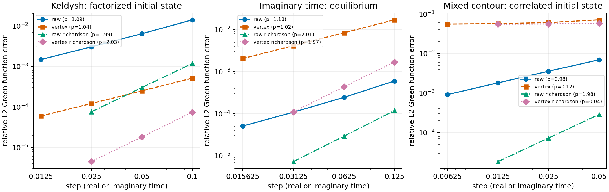

# 顶点移动是否值得做？

**建议：不要把顶点移动当成跨轮廓通用的精度补丁；也不要因为当前 Prony 实现有问题，就认定实轴移动在数学上不可取。** 对当前实轴离散格式，移动确实有收益，但未提高收敛阶。最小修复是把移动后核的局部项、延迟指数尾部和边界分开表示。若希望完全避免移动，当前不移动方案加观测量 Richardson 外推，是本次已验证的简单替代。

本报告为探索性计算记录。数学证明、实测和推测分开叙述；没有将源码注释中的旧结果当作本次新实验。原始数据、脚本和依赖锁定均保存在当前目录，计算全部在 CPU 服务器的指定工作目录内执行。

## 版本与实验

- GTEMPO：`2ef6a2bfc5d01be5532ecfac517eb1f2b870f622`。
- QuAPI：`16f30252df564dcad934aeee3a788ff02b2ebccb`。
- 同时从作者仓库取得 ImpurityModelBase、ExpExp、FiniteMPSAlgorithms、Z2Tensors 的最新 HEAD；准确提交见 [source_versions.txt](results/source_versions.txt)。
- 上述均为 2026-11-03 开始测试时获取的最新默认分支。第三方注册依赖因服务器联网失败使用现有缓存解析，准确版本由 `env/Manifest.toml` 记录；未声称这些第三方依赖都是上游最新版本。
- 服务器：Slurm 作业 `313869`，`node1`，4 CPU、16 GiB 申请内存，Julia 1.12.6，持续复用同一 Julia 进程。

基准为非相互作用单能级加单模费米浴：$β=1$，杂质能量 $ε_d=0.7$，浴能量 $ω=1$，谱权重 $V^2=0.5$。实轴总时长 $T=0.4$；混合轮廓实轴 $T=0.2$，实虚步数同时加密。实轴初态为分离热态；混合轴为耦合平衡态。参考解独立使用二阶单粒子矩阵的精确指数与 Fermi 矩阵，不依赖上游测试中的解析辅助函数。

主测试使用 PartialIF，避免 Prony 误差混入“移动是否改善离散化”的判断。键维上限 160，截断阈值 $10^{-13}$；实际最大键维不超过 32。本次检查的量为全部网格节点上的格林函数向量，误差定义为 $\|g-g_{\mathrm{ref}}\|_2/\|g_{\mathrm{ref}}\|_2$，包含初始节点。

## 1. 实轴收益来自误差常数，并非升阶

下表为本次运行结果；收敛阶由最细两套网格估计。

| 轮廓 | 方法 | 较粗网格误差 | 最细网格误差 | 最细两点收敛阶 |
|---|---|---:|---:|---:|
| 实轴，步数 4 → 32 | 不移动 | 1.420e-2 | 1.485e-3 | 1.04 |
| 实轴，步数 4 → 32 | 移动 | 5.158e-4 | 5.979e-5 | 1.02 |
| 虚轴，步数 8 → 64 | 不移动 | 5.996e-4 | 5.101e-5 | 1.09 |
| 虚轴，步数 8 → 64 | 移动 | 1.704e-2 | 2.057e-3 | 1.01 |
| 混合轴，两段步数 4 → 32 | 不移动 | 6.923e-3 | 9.121e-4 | 0.99 |
| 混合轴，两段步数 4 → 32 | 旧位移规则 | 7.133e-2 | 5.579e-2 | 0.03 |

在本模型上，实轴最细网格移动约好 25 倍，但仍是一阶；虚轴约差 40 倍；混合轴旧位移规则出现明显误差平台。后者不能用继续增加 Prony 阶数或 MPS 键维解决，因为本测试根本未使用 Prony。

图的全部曲线来自 [convergence.csv](results/convergence.csv)，逐节点值见 [greens.csv](results/greens.csv)。外推点标在所用较粗网格的步长处，每个点实际消耗粗、细两套计算，不能把它视为单次同成本比较。不同面板使用不同纵轴范围。

## 2. 为什么“核更正确”有时反而使最终结果变差

我另用 QuAPI 的精确单步传播链 IF 作参照，固定网格，只改变杂化幅度。核误差随耦合幅度的实测幂次为：

| 轮廓 | 不移动 | 移动 |
|---|---:|---:|
| 实轴 | 2.000 | 4.000 |
| 虚轴 | 2.002 | 4.000 |

因此，**相对于这条指定离散链，移动确实匹配了二阶耦合系数**，不是任意调参。可是虚轴最终格林函数却更差。这说明“相对于离散链的核误差”和“相对于连续时间的最终观测量误差”是两个不同判据。

一个完整离散格式还包含系统传播子、初态、观测量插入及轮廓闭合。只移动 IF 会改变它们的相对位置。现有数据不单独确定虚轴变差究竟来自哪一项补偿或错配，因此不把具体误差抵消机制当作已证明事实。

尤其需要避免一种误解：连续高斯浴的 IF 本身就是精确二次型。精确离散链核含有更高次耦合依赖，不表示连续浴漏掉了高阶累积量；它们针对的是不同离散对象。推导见 [mathematics.md](docs/mathematics.md)。

数据见 [kernel_coupling_scaling.csv](results/kernel_coupling_scaling.csv)。这里只测试实、虚两轴的核耦合标度，没有宣称混合轴的旧位移规则具有同样性质。

## 3. Prony 的根本障碍是不存在的，实现上的缺项确实存在

指数和整体平移仍是指数和，极点不变。困难是移动把原来的等时积分放到了最近邻位置，得到“独立局部系数＋延迟一格的光滑尾部”，它一般不是一条从第一点开始平滑延续的指数序列。

当前 GTEMPO 的 `src/influencefunctional/ttiif/util.jl` 明确禁用了这项最近邻修正；`src/mpo/mpohamiltonian/schurmpo/exponentialdecay.jl` 又在末端算符额外乘极点。于是用极小极点模拟接触项需要很大的系数，会产生不稳定。还需注意尾部下标及用于拟合的人造最远滞后；仅把被注释的修正重新打开并不够。

稳定的目标表示为：最近邻系数独立保存；从第二个滞后开始只拟合光滑尾部。增加一个延迟状态即可用有限状态 MPO 精确表示，无需除以极小极点，也无需提高 Prony 阶数。

本次用作者最新 ExpExp，在单模和三模谱、三组网格上重建该序列，最大绝对误差约 $3.2×10^{-18}$。另对含零极点、复极点的延迟状态 MPO 做直接收缩验证。原始记录为 [prony_sequences.csv](results/prony_sequences.csv) 和 [delay_mpo.csv](results/delay_mpo.csv)。这两项分别验证真实浴序列和有限状态表示；不冒充对整个 GTEMPO TTI 生产流程的验证。

我还做了 GTEMPO 端到端的研究性修正对照：把两组尾部放回正确的上下三角算符通道，正确处理尾部下标，排除不实际使用的人造最远滞后，再以解析幂零门补局部和边界项。步数 3、4、8 的核相对误差降至约 $4.6×10^{-13}$、$7.8×10^{-13}$、$1.3×10^{-11}$。修正前，当前 ExactTTIIF 的相同核相对误差约为 0.97、0.86、0.83；PartialIF 则接近浮点精度。

这不表示最终观测量也有 80% 的误差：IF 接近真空时，核本身很小，核相对误差可能被归一化 IF 的小相对误差掩盖。因此本次特意逐个提取二次系数，而没有只沿用宽松的整态误差阈值。还在每套网格抽查了 256 个一至四对 Grassmann 腿的归一化系数，修正后最大绝对差异为 $2.2×10^{-14}$。表中整态相减范数返回的零值受浮点相消影响，不作为零误差证明。

修正见 [repaired_tti.jl](scripts/repaired_tti.jl)，记录见 [repaired_tti.csv](results/repaired_tti.csv) 和 [tti_kernel_audit.csv](results/tti_kernel_audit.csv)。它是可复核的构造性研究脚本，局部修正系数通过提取已有 MPS 核来校验；还不是高效的通用生产补丁。生产实现应直接由拟合系数求局部补偿，或使用上述延迟状态 MPO，并对多种排序、一般谱及其他 TTI 算法扩展验证。只补最近邻项的失败控制另存为 `repaired_tti_contact_only.csv`，没有隐藏该负结果。

## 4. 不移动时，最简单的已验证替代是观测量外推

对同一物理时间分别计算步长 $h$ 和 $h/2$ 的归一化观测量，取 $O_R=2O_{h/2}-O_h$。若原方法具有稳定的一阶误差展开，就能消去一阶项。

不移动格式的外推，本次三条轮廓的全网格拟合阶分别为：实轴 1.99、虚轴 2.01、混合轴 1.98。混合轴同步缩小实虚步长。最细外推误差分别为 $7.57×10^{-5}$、$7.26×10^{-6}$、$1.83×10^{-5}$。

这不需要修改 IF 构造或 Prony。代价是粗、细两次运行；它不保证外推后的完整密度矩阵为正，也不能消除拟合、压缩、浴离散或错误边界造成的偏差。实轴“移动后再外推”同样有效，本次最细外推误差约 $4.46×10^{-6}$；没有理由把外推与是否移动强行绑定。

## 5. 选择建议

还做了一个从单步传播子推导端点的替代实验：QuAPI 精确单步 IF，加匹配的杂质半步相位，再用 GTEMPO 的逐行解析门收缩。这对应“杂质半步—浴与杂化整步—杂质半步”的对称链，没有对已装配矩阵事后移动索引。

在同一实轴基准上，步数 4、8、16、32 的误差分别为 $1.440×10^{-4}$、$3.497×10^{-5}$、$8.613×10^{-6}$、$2.137×10^{-6}$，接近二阶。与独立单粒子对称链的差异不超过 $8.8×10^{-12}$；附带行列式因子后的迹偏差不超过 $4.4×10^{-12}$。杂质能量为零时，精确单步链无需系统分裂，误差达到约 $10^{-11}$ 的本次收缩精度。

这个对照也包含一个失败控制：若直接把精确 IF 乘到原系统传播子上，却不给 IF 端点补相应系统相位，非零杂质能量下仍不等于该离散链。因此“直接换精确核”不是可无条件使用的替换接口。实验文件为 [link_if_strang.csv](results/link_if_strang.csv)、[link_if.csv](results/link_if.csv)、[link_if_naive_control.csv](results/link_if_naive_control.csv)，构造见 [link_if.jl](scripts/link_if.jl)。

该相位适配目前只实现了普通非相互作用单能级。对相互作用系统，必须保留或重新推导对应局部传播子的双侧腿，不能照搬这里的标量相位。精确 Schur 参照也没有证明长时和连续谱下更便宜。

如果目的是维护现有求解器，我优先保留当前已经验证有收益的实轴选项，将局部项、延迟尾部、边界明确分开；不把同一位移搬到虚轴和混合轴。核生成器、系统传播子和观测量都应有显式的离散约定。

如果目的是避免特殊位移而尽快取得高精度结果，先用当前不移动格式加网格外推。这是本次跨三条轮廓都已验证的最小改动。

如果目的是开发统一的二阶算法，从一致的相干态单步传播子及对称分裂推导端点，再消去浴，比事后逐块搬索引更清楚。QuAPI 已有精确单步链的 Schur 接口，可作校准参照；但显式浴消元可能昂贵，其有限初态核也未必是简单 Toeplitz 核，不能直接宣称比原 Prony 算法便宜。

适用边界：本次数值结论针对普通数守恒、非相互作用杂质和少模浴。没有将误差常数或最优方案外推到相互作用、BCS、长时或低温极限。关于“平移仍保留指数结构”和“局部项可精确因子化”的代数结论比这些数值基准更普遍。
